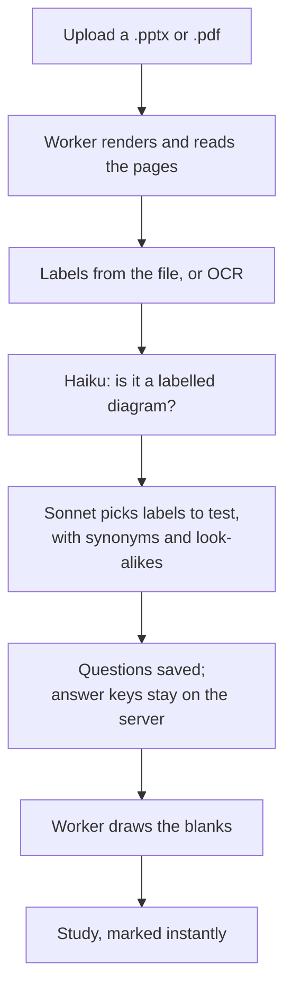

# FigureQuiz

**Your lecture slides, turned into the exam.** FigureQuiz turns a student's own PowerPoint and
PDF lecture files into practice questions, including the kind other study tools don't make:
diagram questions, where the labels on a lecture figure are blanked out and the student types
them back in.

**Try it:** https://figurequiz.online

## What it does

- **Diagram questions from your own slides.** Labels come from the file itself when they are
  separate text boxes (Tier 1), or from OCR when they are baked into the picture (Tier 2). Blank
  positions always come from the file or OCR, never from an AI model's guess, so a blank can't
  miss its label and show the answer.
- **Table questions:** cells blanked from the tables in your slides.
- **Text questions too:** multiple choice, fill-in-the-blank, flashcards, and short essays
  marked against a rubric.
- **Fair, instant marking.** Typed answers are marked without an AI call: typos are forgiven,
  synonyms accepted, and look-alike wrong answers (efferent for afferent) rejected, because each
  question stores them when it is written.
- **Every question links back to its slide**, shown once you've answered.
- Works on a phone, and a guest can try one deck before signing up.

## How it works



| Folder | What it is |
|---|---|
| `web/` | Next.js (App Router, TypeScript) on Vercel: the app, sign-in, question generation and marking |
| `ingest/` | Python 3.11 worker: reads PPTX (python-pptx) and PDF (PyMuPDF), renders pages with LibreOffice, runs Tesseract OCR and draws blanks with Pillow |
| `supabase/` | Postgres schema with row-level security on every table, storage, job queues (pgmq) and database tests |
| `contracts/` | Example payloads that both services' tests check against the shared schemas |

Claude models write the questions, through OpenRouter: Haiku 5.5 for cheap checks and simple text
questions, Sonnet 5.5 wherever a wrong answer key would mis-mark a student. The worker never calls
a model; it only extracts.

## Results

Measured in production on four real lecture decks: 65 questions of six types, about 1.9¢ of AI
per deck, ready about 42 seconds after upload. 467 automated tests cover marking, the database's
security rules and the worker.

## Running it locally

You need Node 20 or later, Docker and the Supabase CLI.

```bash
supabase start                       # local Postgres, auth, storage and queues
cp web/.env.example web/.env.local   # then fill in the values it lists
cd web && npm ci && npm run dev      # http://localhost:3000
```

The worker needs LibreOffice and Tesseract, so it runs in its Docker image:

```bash
cp ingest/.env.example ingest/.env   # then fill it in
docker build -t ingest:dev ingest/
docker run --rm --env-file ingest/.env ingest:dev
```

Tests: `npx vitest run` in `web/`, `pytest` in `ingest/`, and `supabase test db`.

The sample deck behind `/demo` uses a third-party brain diagram, so this repository ships a
placeholder in its place; the live site shows the real one.

## About

A student capstone project by Andy Kurniawan, 2026, built with Claude Code as a pair programmer.

## Licence

Copyright (C) 2026 Andy Kurniawan. FigureQuiz is free software under the
[GNU Affero General Public License v3.0](LICENSE), the same licence as PyMuPDF, which the worker
uses to read PDFs.
