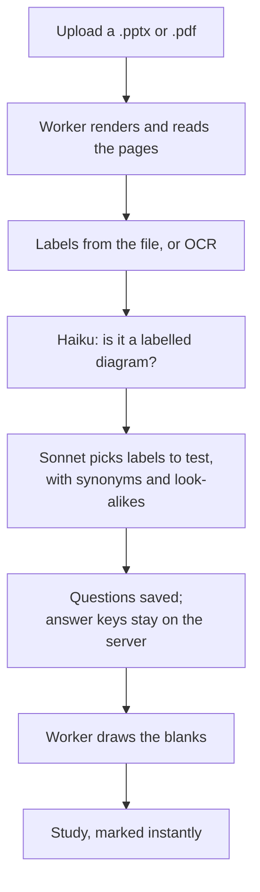

# FigureQuiz

**Your lecture slides, turned into the exam.** FigureQuiz turns a student's own PowerPoint and
PDF lecture files into practice questions, including the kind other study tools don't make:
diagram questions, where the labels on a lecture figure are blanked out and the student types
them back in.

**To test it you only need a web browser.** It's live at https://figurequiz.online, so there is
no code to run: see [Try it online](#try-it-online). To run the code yourself, see
[Run it on your own computer](#run-it-on-your-own-computer).

## Try it online

FigureQuiz runs in the cloud, so there is nothing to install. It works on a computer or a phone.

1. **Make an account.** Open https://figurequiz.online/signup, enter an email address and a
   password of at least 8 characters, and press **Create account**. No confirmation email is
   sent: you are signed in straight away, with 100 free credits. Please use email and password
   here, because **Continue with Google** only works for approved test accounts for now.
2. **Upload a lecture.** Press **Choose a file** and pick a `.pptx` or `.pdf` up to 50 MB (PDFs
   can have up to 100 pages). Each page that gets questions uses one credit, and an account can
   upload 10 files a month. If you don't have a lecture to hand, use a file from the `samples`
   folder, such as the 4-slide
   [`Brain_Anatomy_Sample.pptx`](https://github.com/MRndy1/figurequiz/raw/main/samples/Brain_Anatomy_Sample.pptx).
3. **Wait a minute or two.** The page shows the deck being made. It can say "in line" for the
   first 30 seconds or so, while the cloud worker starts. You can leave the page: the deck keeps
   going, and it waits for you under **Decks**.
4. **Study.** Press **Start studying**. Diagram questions come first: type each missing label onto
   the diagram, then press **Check answers**.

Things worth trying:

- **Marking:** misspell a label by one letter, and it is marked "right, typo forgiven". Type a
  label from elsewhere on the diagram, and it is marked wrong.
- **Sources:** once you have answered a question, **View the slide** shows where it came from.
- **Essays:** a written answer is marked by AI against a rubric, for 2 credits.
- **Phone:** sign in to the same account on a phone and carry on where you left off.

**No account?** The [sample deck](https://figurequiz.online/demo) is open to everyone, and
dropping a file on the [home page](https://figurequiz.online) makes a guest deck with its first
3 questions open.

## What it does

- **Diagram questions from your own slides.** Labels come from the file itself when they are
  separate text boxes (Tier 1), or from OCR when they are baked into the picture (Tier 2). Blank
  positions always come from the file or OCR, never from an AI model's guess, so a blank can't
  miss its label and show the answer.
- **Table questions:** cells blanked from the tables in your slides.
- **Text questions too:** multiple choice, fill-in-the-blank, flashcards, and short essays
  marked against a rubric.
- **Fair, instant marking.** Typed answers are marked without an AI call: typos are forgiven,
  synonyms accepted, and look-alike wrong answers (efferent for afferent) rejected, because each
  question stores them when it is written.
- **Every question links back to its slide**, shown once you've answered.
- Works on a phone, and a guest can try one deck before signing up.

## How it works



| Folder | What it is |
|---|---|
| `web/` | Next.js (App Router, TypeScript) on Vercel: the app, sign-in, question generation and marking |
| `ingest/` | Python 3.11 worker: reads PPTX (python-pptx) and PDF (PyMuPDF), renders pages with LibreOffice, runs Tesseract OCR and draws blanks with Pillow |
| `supabase/` | Postgres schema with row-level security on every table, storage, job queues (pgmq) and database tests |
| `contracts/` | Example payloads that both services' tests check against the shared schemas |
| `samples/` | Files to upload when trying it out |

It all runs in the cloud, so a student can upload from a phone and nothing has to run on anyone's
computer. The web app is on Vercel, and the database, sign-in, files and queues are on Supabase.
The worker is an Azure Container Apps job ([`ingest/azure-job.yaml`](ingest/azure-job.yaml)): Azure
checks the queue every 15 seconds, starts a run when an upload is waiting, and scales back to zero
when the queue is empty. GitHub Actions builds its image.

Claude models write the questions, through OpenRouter: Haiku 5.5 for cheap checks and simple text
questions, Sonnet 5.5 wherever a wrong answer key would mis-mark a student. The worker never calls
a model; it only extracts.

## Results

Measured in production on four real lecture decks: 65 questions of six types, about 1.9¢ of AI
per deck, ready about 42 seconds after upload. 495 automated tests cover marking, the database's
security rules and the worker.

## Run it on your own computer

You don't need any of this to test the site. Commands are for macOS or Linux; on Windows, run
them in WSL.

### The sample deck only

This runs with no accounts or keys, and with no internet once it is installed. You need
[Node 20 or later](https://nodejs.org/). From the top folder:

```bash
cd web
npm ci
npm run dev
```

Then open http://localhost:3000/demo. Without the internet the terminal warns that it can't
download the fonts, and the page uses plainer ones. Only the sample deck works this way: signing
in and uploading need the whole app.

### The whole app

This runs the app, database and worker on your computer. It still needs the internet, because
Claude writes the questions through OpenRouter.

You need Node 20 or later, [Docker](https://docs.docker.com/get-docker/) (keep it running), the
[Supabase CLI](https://supabase.com/docs/guides/local-development/cli/getting-started) and an
[OpenRouter API key](https://openrouter.ai/keys) with a little credit: a deck costs about 2¢.
Start from the top folder of a fresh copy, because step 2 writes `web/.env.local` and
`ingest/.env`.

**1. Start the local database, sign-in, file storage and queues.** The first run downloads
several Docker images.

```bash
supabase start
```

**2. Write the settings files.**

```bash
eval "$(supabase status -o env 2>/dev/null | grep -E '^(API_URL|PUBLISHABLE_KEY|SECRET_KEY)=')"
CALLBACK_SECRET=$(openssl rand -hex 32)

cat > web/.env.local <<EOF
NEXT_PUBLIC_SUPABASE_URL=$API_URL
NEXT_PUBLIC_SUPABASE_PUBLISHABLE_KEY=$PUBLISHABLE_KEY
SUPABASE_SECRET_KEY=$SECRET_KEY
INGEST_CALLBACK_SECRET=$CALLBACK_SECRET
SIGNUPS_ENABLED=true
DAILY_BUDGET_USD=1
EOF

cat > ingest/.env <<EOF
SUPABASE_URL=http://host.docker.internal:54321
SUPABASE_SECRET_KEY=$SECRET_KEY
INGEST_CALLBACK_URL=http://host.docker.internal:3000/api/ingest/callback
INGEST_CALLBACK_SECRET=$CALLBACK_SECRET
EOF
```

Then open `web/.env.local` in a text editor and add your key as a new line:

```
OPENROUTER_API_KEY=your-key-here
```

**3. Start the app.**

```bash
cd web
npm ci
npm run dev
```

**4. Start the worker, in a second terminal, from the top folder.** It needs LibreOffice and
Tesseract, so it runs in Docker. The first build takes a few minutes.

```bash
docker build -t ingest:dev ingest/
docker run --rm --add-host=host.docker.internal:host-gateway --env-file ingest/.env ingest:dev
```

**5. Use it.** Open http://localhost:3000/signup, make an account and upload a file, as in
[Try it online](#try-it-online). Accounts here are local, so any email address works.

If the key is missing or wrong, the deck stops with "Writing questions failed", and the first
terminal says why. Your credits aren't touched: fix the key, restart `npm run dev`, and press
**Try again** on the deck.

To stop, press Ctrl+C in both terminals, then run `supabase stop`.

### Tests

```bash
cd web && npx vitest run      # after npm ci
cd ingest && uv run pytest    # needs uv: https://docs.astral.sh/uv/
supabase db reset && supabase test db   # with supabase running; reset empties the local database
```

## Sample deck

`samples/Brain_Anatomy_Sample.pptx` is the deck behind `/demo`. Its text is adapted from Johns
Hopkins Medicine's *Brain Anatomy and How the Brain Works*. Its diagram is Figure 728 of *Gray's
Anatomy* (1918), public domain, from
[Wikimedia Commons](https://commons.wikimedia.org/wiki/File:Lobes_of_the_brain_NL.svg), with
labels added for FigureQuiz (`web/data/demo/brain-lobes.svg`).

## About

A student capstone project by Andy Kurniawan, 2026, built with Claude Code as a pair programmer.

## Licence

Copyright (C) 2026 Andy Kurniawan. FigureQuiz is free software under the
[GNU Affero General Public License v3.0](LICENSE), the same licence as PyMuPDF, which the worker
uses to read PDFs.
